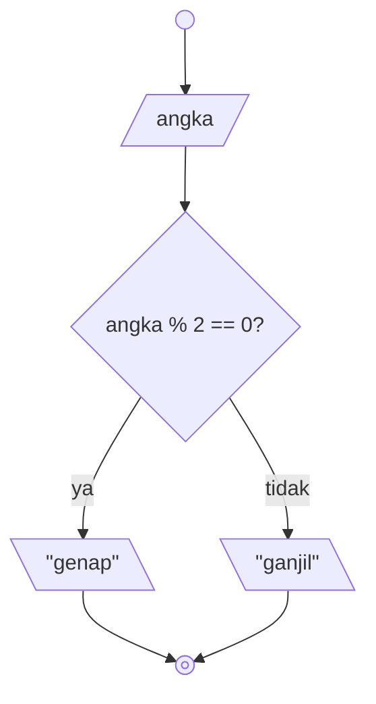
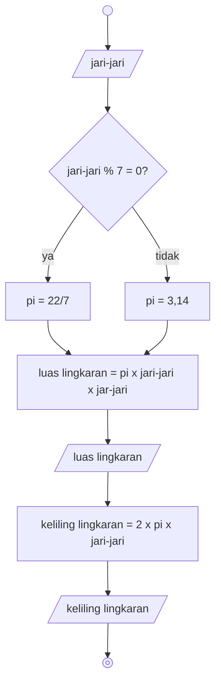

# Algoritma

## Algoritma memindahkan air

Menukar isi dari gelas teh dengan isi dari gelas kopi.

1. Mulai
2. Sediakan gelas kosong tambahan
3. Tuangkan isi gelas teh ke dalam gelas kosong
4. Tuangkan isi gelas kopi ke dalam gelas teh
5. Tuangkan isi gelas kosong ke dalam gelas kopi
6. Selesai

## Algoritma menentukan bilangan ganjil atau genap

### Deskriptif

1. Mulai
2. Masukkan sebuah angka
3. Hitung hasil dari pembagian (modulus) angka tersebut dengan bilangan 2
4. Jika hasil dari pembagian tersebut bukan 0, tampilkan angka tersebut sebagai ganjil
5. Jika tidak, tampilkan angka tersebut sebagai genap
6. Selesai

### Flowchart



### Pseudo

```pseudo
DECLARE angka : INTEGER
INPUT angka
IF angka MOD 2 = 0 THEN
    OUTPUT "genap"
ELSE
    OUTPUT "ganjil"
ENDIF
```

## Algoritma hitung luas dan keliling lingkaran

### Deskriptif

1. Mulai
2. Masukkan sebuah angka sebagai jari-jari
3. Jika modulus dari **jari-jari** dan 7 adalah 0, gunakan 22/7 sebagai *pi*
4. Jika tidak, maka gunakan 3,14 sebagai *pi*
5. **Untuk luas lingkaran**, lakukan perkalian *pi* dengan **jari-jari** kuadrat
6. Tampilkan hasil perkalian sebagai **luas lingkaran**
7. **Untuk keliling lingkaran**, lakukan perkalian *pi* dengan bilangan **2** dan **jari-jari**
8. Tampilkan hasil perkalian terakhir sebagai **keliling lingkaran**
9. Selesai

### Flowchart



### Pseudo

```pseudo
DECLARE jariJari : INTEGER
DECLARE luasLingkaran : REAL
DECLARE kelilingLingkaran : REAL
DECLARE pi : REAL

INPUT jariJari

IF jariJari MOD 7 = 0 THEN
    pi <- 22/7
ELSE
    pi <- 3.14
ENDIF

luasLingkaran <- pi * jariJari * jariJari
OUTPUT luasLingkaran

kelilingLingkaran <- 2 * pi * jariJari
OUTPUT kelilingLingkaran
```
